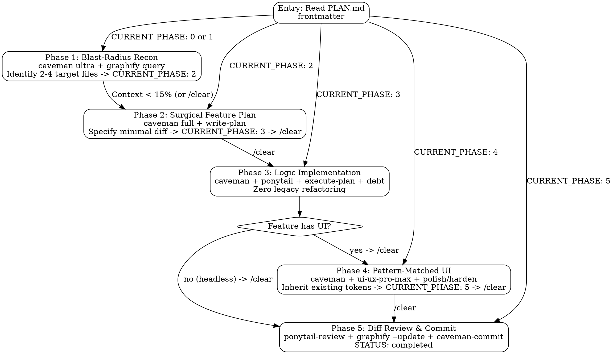

# Vibe Add Feature

## Overview

Add features to an existing codebase with minimal token overhead by isolating the topological blast radius via `graphify` first, then executing surgical minimal-diff logic and pattern-matched UI polish across isolated phases.

Core principle: **Isolate dependencies before touching files. Write the shortest working diff. Never refactor surrounding untouched code.**



## When to Use

- Adding a new feature, module, API route, or UI view to an established repository
- Extending current functionality without breaking, reformatting, or re-styling surrounding code
- Resuming an in-progress brownfield feature build after running `/clear`

**When NOT to use:**
- Building a greenfield project from scratch (use `vibe-fresh-project`)
- Fixing a bug, broken test, or regression (use `vibe-fix-bug`)
- Initializing workspace rules and configs (use `vibe-init`)

---

## Phase State Handshake (On Every Entry)

Inspect the YAML frontmatter of `PLAN.md` before executing any actions:

```markdown
---
PIPELINE: add-feature
CURRENT_PHASE: <phase_number>
STATUS: <idle|in_progress|completed>
---
```

1. **Fast-Forward from `vibe-explore-audit`:** If `PLAN.md` has `PIPELINE: add-feature` and `CURRENT_PHASE: 2` (routed after exploration mapped the missing capability blast radius), jump directly to **Phase 2: Surgical Feature Plan**. Skip Phase 1 recon!
2. **Resuming after `/clear`:** If `PIPELINE: add-feature` is active and `CURRENT_PHASE > 0`: jump directly to that phase.
3. **Starting Fresh:** Set `PIPELINE: add-feature`, `CURRENT_PHASE: 1`, `STATUS: in_progress`, and proceed to Phase 1.

---

## 5-Phase Brownfield Pipeline

### Phase 1: Topological Blast-Radius Recon
**Tools:** `caveman ultra` + `graphify`

> [!IMPORTANT]
> **Check Graph Freshness:** If `graphify-out/GRAPH_REPORT.md` is missing or stale, run `/graphify --update` before querying.

1. Activate ultra-compact mode:
   ```
   /caveman ultra
   ```
2. Query the knowledge graph to trace dependencies, callers, shared types, and entry points:
   ```
   /graphify query "trace dependencies and entry points for [feature domain]"
   ```
3. **Read ONLY the 2 to 4 target files** returned by the graph query. Do NOT grep the repository or dump entire directories.
4. Record exact target file paths, contracts, and integration points in `PLAN.md`.
5. Update `PLAN.md` frontmatter:
   ```yaml
   PIPELINE: add-feature
   CURRENT_PHASE: 2
   STATUS: in_progress
   ```
6. **Transition Gate:** If context usage is under 15%, proceed directly to Phase 2; otherwise prompt for `/clear`:
   ```
   phase 1 complete: 2-4 target files mapped in PLAN.md.
   run /clear then invoke vibe-add-feature
   ```

---

### Phase 2: Surgical Feature Plan
**Tools:** `caveman full` + `superpowers:write-plan`

1. Feed **only** the target files mapped in Phase 1 into `superpowers:write-plan`.
2. Formulate a minimal-diff plan in `PLAN.md`:
   - Exact lines/functions to touch in existing files.
   - New test file locations and test cases.
   - Zero opportunistic cleanup or reformatting of legacy helper code.
3. Update `PLAN.md` frontmatter:
   ```yaml
   PIPELINE: add-feature
   CURRENT_PHASE: 3
   STATUS: in_progress
   ```
4. **STOP.** Output the readiness prompt:
   ```
   phase 2 complete: minimal-diff plan written to PLAN.md.
   run /clear then invoke vibe-add-feature
   ```

---

### Phase 3: Minimal-Diff Logic Implementation
**Tools:** `caveman full` + `ponytail full` + `superpowers:execute-plan` + `ponytail-debt`

> [!CAUTION]
> **Strict Diff Discipline:** Never reformat, re-indent, or refactor untouched functions in existing files. Preserve surrounding code and comments verbatim.

1. Read `PLAN.md` to retrieve target tasks.
2. Execute backend routes, services, data queries, and client hooks using Red-Green-Refactor TDD.
3. Log any intentional shortcuts, deferred refactors, or architectural debt:
   ```
   /ponytail-debt
   ```
4. Verify all tests pass.
5. **UI Branching Gate:**
   - **If the feature has NO UI (headless/API-only):** set `CURRENT_PHASE: 5` in `PLAN.md` and prompt for `/clear` (skipping Phase 4).
   - **If the feature includes UI changes:** set `CURRENT_PHASE: 4` in `PLAN.md` and prompt for `/clear`.
6. Output the readiness prompt:
   ```
   phase 3 complete: logic green, diff minimal, debt logged.
   run /clear then invoke vibe-add-feature
   ```

---

### Phase 4: Pattern-Matched UI & Polish
**Tools:** `caveman full` + `ui-ux-pro-max` + `impeccable` (`polish`, `harden`)

> [!WARNING]
> **Token & Pattern Inheritance Rule:** Never allow `ui-ux-pro-max` to invent a new color palette, font family, or custom card styles in an established repository. Force it to inherit existing Tailwind classes and CSS variables discovered in Phase 1.

1. Scaffold the new UI component or view using `ui-ux-pro-max`, strictly constrained to existing project tokens.
2. Wire component to Phase 3 hooks/endpoints.
3. Immediately run `impeccable:polish` and `impeccable:harden` on touched UI files:
   - Verify visual harmony with existing screens.
   - Enforce minimum 44×44px hit targets and tactile feedback (`:active { transform: scale(0.97); }`).
   - Audit empty, loading, and error states.
   - Audit accessibility and tabular numerals (`tabular-nums`) where appropriate.
4. Update `PLAN.md` frontmatter:
   ```yaml
   PIPELINE: add-feature
   CURRENT_PHASE: 5
   STATUS: in_progress
   ```
5. **STOP.** Output the readiness prompt:
   ```
   phase 4 complete: ui scaffolded, pattern-matched, and hardened.
   run /clear then invoke vibe-add-feature
   ```

---

### Phase 5: Diff Review, Graph Update & Commit
**Tools:** `ponytail full` (`ponytail-review`) + `graphify` + `caveman-commit`

1. Run `ponytail-review` against the git diff:
   - Identify and revert stray whitespace edits, accidental reformatting, or unneeded abstractions.
   - Verify that touched lines correlate 100% with feature requirements.
2. Incrementally update the AST knowledge graph:
   ```
   /graphify --update
   ```
3. Update `PLAN.md` frontmatter:
   ```yaml
   PIPELINE: add-feature
   CURRENT_PHASE: 5
   STATUS: completed
   ```
4. Commit changes using `caveman-commit`:
   ```
   /caveman-commit
   ```
5. Output final telegraphic completion summary:
   ```
   done: feature added. diff clean, graph updated, committed.
   ```

---

## Quick Reference

| Phase | Purpose | Active Tools | Key Constraints | Next Transition |
|---|---|---|---|---|
| **Phase 1** | Blast-Radius Recon | `caveman ultra`, `graphify query` | Read only 2–4 target files; no raw grep | `CURRENT_PHASE: 2` (or `/clear`) |
| **Phase 2** | Surgical Plan | `caveman full`, `write-plan` | Minimal diff only; zero legacy cleanup | `CURRENT_PHASE: 3` -> `/clear` |
| **Phase 3** | Logic TDD & Debt | `caveman`, `ponytail`, `execute-plan`, `ponytail-debt` | Zero reformatting; log debt | `CURRENT_PHASE: 4` (or 5 if no UI) -> `/clear` |
| **Phase 4** | Pattern-Matched UI | `caveman`, `ui-ux-pro-max`, `impeccable` | Inherit existing tokens; polish + harden | `CURRENT_PHASE: 5` -> `/clear` |
| **Phase 5** | Diff Review & Commit | `ponytail-review`, `graphify --update`, `caveman-commit` | Strip diff bloat; sync graph | `STATUS: completed` |

---

## Rationalization Table

| Excuse | Reality |
|---|---|
| "I'll grep the repo because it's faster than querying graphify" | Grepping 50k lines dumps thousands of tokens and misses structural AST call graphs. `/graphify query` isolates exact 2–4 files. |
| "While I'm in `billing.ts`, I'll tidy up legacy helper functions" | Opportunistic refactoring bloats git blame, risks breaking unmapped callers, and causes regressions. Refactoring belongs in a separate PR. |
| "The user asked for a cool new purple gradient and fresh font for the button" | Brownfield UI must match existing house tokens (`client/theme.css`). Inventing uncurated gradients or rogue fonts introduces AI-slop visual inconsistency. |
| "I will implement backend and UI together to save time" | Mixing backend queries and UI styling in one context causes token exhaustion and degraded focus. Phased handoffs keep context clean. |
| "The feature has no UI, but I'll run Phase 4 anyway" | Headless/API features skip Phase 4 completely and jump from Phase 3 directly to Phase 5. |

---

## Red Flags - STOP and Correct

- Running recursive grep across `server/` or `client/` instead of querying graphify.
- Modifying or reformatting lines of code outside the immediate feature integration points.
- Inventing new palettes, font families, or custom widget styles instead of reusing existing tokens.
- Proceeding through phases without logging architectural shortcuts to `ponytail-debt`.
- Skipping Phase 5 `ponytail-review` before committing.
