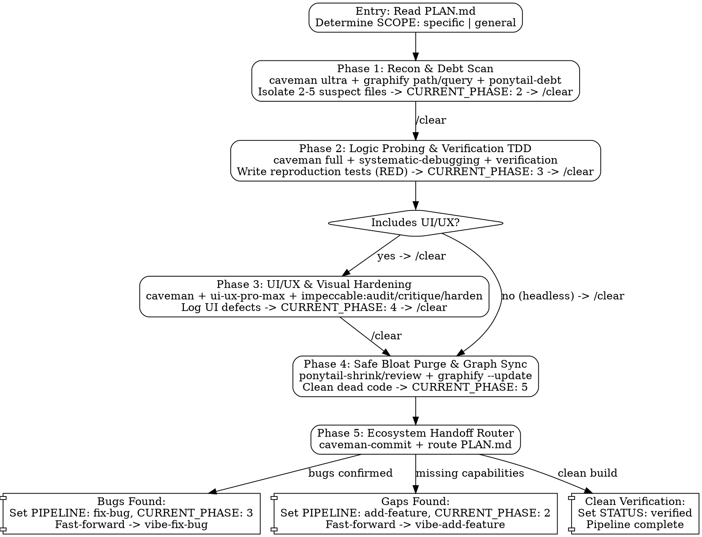

# Vibe Explore Audit

## Overview

The central quality gate and diagnostic router connecting `vibe-init`, `vibe-fresh-project`, `vibe-add-feature`, and `vibe-fix-bug`. Explores, verifies, and audits either an entire repository (General Mode) or a specific suspect/completed feature (Specific Mode) across 5 context-isolated phases.

Core principle: **Never rewrite core feature logic inside exploration. Prove root causes with reproduction tests, then fast-forward `PLAN.md` into `vibe-fix-bug` (Phase 3) or `vibe-add-feature` (Phase 2).**



## When to Use

- Investigating why a specific feature, workflow, or component is not working properly ("audit/verify this feature, why is it acting weird?")
- Verifying a completed build immediately after `vibe-fresh-project` or `vibe-add-feature`
- Exploring an existing codebase after `vibe-init` to uncover hidden bugs, race conditions, silent failures, and technical debt
- Auditing frontend views for UX gaps, layout shifts, contrast defects, and missing loading/empty/error states
- Pre-isolating root causes and failing tests so `vibe-fix-bug` or `vibe-add-feature` can skip recon phases

**When NOT to use:**
- Writing greenfield code from scratch (use `vibe-fresh-project`)
- Implementing a brand new feature specification (use `vibe-add-feature`)
- Directly applying surgical fixes to an already-reproduced bug (use `vibe-fix-bug`)

---

## Phase State Handshake & Scope Mode (On Every Entry)

Inspect the YAML frontmatter of `PLAN.md` before executing any actions:

```markdown
---
PIPELINE: explore-audit
SCOPE: <specific (<target-feature>) | general>
CURRENT_PHASE: <phase_number>
STATUS: <in_progress|verified|completed>
---
```

1. **Resuming After `/clear`:** If `PIPELINE: explore-audit` is active, jump directly to `CURRENT_PHASE`.
2. **Specific Mode (Feature Verification / Symptom Probe):** If user targets a specific feature (or if `PLAN.md` shows `STATUS: completed` from `vibe-fresh-project` or `vibe-add-feature`), set `PIPELINE: explore-audit`, `SCOPE: specific (<feature-name>)`, `CURRENT_PHASE: 1`, and `STATUS: in_progress`.
3. **General Mode (Full-Repo Exploration & Audit):** If user requests a general codebase audit or bug hunt after `vibe-init`, set `PIPELINE: explore-audit`, `SCOPE: general`, `CURRENT_PHASE: 1`, and `STATUS: in_progress`.

---

## 5-Phase Exploration & Audit Pipeline

### Phase 1: Topological Anomaly & Call-Path Recon
**Tools:** `caveman ultra` + `graphify` + `ponytail-debt`

1. Switch to ultra-compact mode:
   ```
   /caveman ultra
   ```
2. Isolate suspect code topologically without reading raw directories:
   - **In Specific Mode:** Run `graphify path` and `graphify explain` on target feature:
     ```
     /graphify path "from [feature entry view] to [API/state handler]"
     /graphify explain "[feature domain/module]"
     ```
   - **In General Mode:** Query AST report for architectural anomalies:
     ```
     /graphify query "identify high-coupling god nodes, circular dependencies, and unguarded state stores"
     ```
3. **Debt Scan:** Run `ponytail-debt` to surface shortcuts logged during prior pipeline runs:
   ```
   /ponytail-debt
   ```
4. Record the top 2 to 5 suspect file paths and line ranges in `PLAN.md`.
5. Update `PLAN.md`: `CURRENT_PHASE: 2`.
6. Output readiness prompt and pause for `/clear`:
   ```
   phase 1 complete: suspect paths and debt mapped in PLAN.md.
   run /clear then invoke vibe-explore-audit
   ```

---

### Phase 2: Logic Probing, Root-Cause Diagnosis & Verification TDD
**Tools:** `caveman full` + `superpowers:systematic-debugging` + `superpowers:verification-before-completion`

> [!CAUTION]
> **No Premature Patching:** Do NOT rewrite feature code in this phase. Your objective is to formulate verifiable hypotheses and lock down failing reproduction tests.

1. Read **only** the suspect files recorded in `PLAN.md`.
2. Trace data flow, async race conditions, stale closures, boundary inputs, and auth guards using `superpowers:systematic-debugging`.
3. Write minimal diagnostic assertions or automated reproduction tests confirming exact failure mechanisms (**RED**).
4. Record every verified bug, its reproduction test path, and the root cause in `PLAN.md`.
5. Update `PLAN.md`: `CURRENT_PHASE: 3` (or jump to `Phase 4` if headless backend with no UI).
6. Output readiness prompt and pause for `/clear`:
   ```
   phase 2 complete: root causes diagnosed and reproduction tests locked (RED).
   run /clear then invoke vibe-explore-audit
   ```

---

### Phase 3: UI/UX Flow & Visual Hardening Audit
**Tools:** `caveman full` + `ui-ux-pro-max` + `impeccable` (`audit`, `critique`, `harden`)

> [!TIP]
> **Skip on Headless/API Logic:** If the scope involves backend services, APIs, or database logic only, **SKIP Phase 3 COMPLETELY** to save tokens and proceed to Phase 4.

1. Load `ui-ux-pro-max` to audit user interaction flows, design token alignment, and mobile responsiveness.
2. Execute visual and DOM audit:
   ```
   /impeccable:audit
   /impeccable:critique
   /impeccable:harden
   ```
3. Audit for:
   - Layout shifts and horizontal overflow.
   - Text measure (`<= 65ch`) and tabular numbers (`tabular-nums`).
   - Touch targets (`>= 44x44px`) and tactile compression (`scale(0.97)`).
   - Missing loading, empty, and error fallback states.
   - Redundant DOM wrappers.
4. Record confirmed UI issues in `PLAN.md`.
5. Update `PLAN.md`: `CURRENT_PHASE: 4`.
6. Output readiness prompt and pause for `/clear`:
   ```
   phase 3 complete: ui/ux audited and DOM hardening recorded in PLAN.md.
   run /clear then invoke vibe-explore-audit
   ```

---

### Phase 4: Safe Bloat Purge & Graph Sync
**Tools:** `caveman full` + `ponytail-shrink` + `ponytail-review` + `graphify`

1. Run `ponytail-shrink` and `ponytail-review` on audited files to safely strip dead imports, unused helper variables, and unreferenced exports (zero logic alteration):
   ```
   /ponytail full
   /ponytail-shrink
   /ponytail-review
   ```
2. Incrementally synchronize the AST knowledge graph:
   ```
   /graphify --update
   ```
3. Update `PLAN.md`: `CURRENT_PHASE: 5`.

---

### Phase 5: Ecosystem Handoff Router & Commit
**Tools:** `caveman ultra` + `caveman-commit`

Commit reproduction tests, safe dead-code cleanup, and `PLAN.md` audit findings:
```
/caveman-commit
```

Then evaluate audit findings and route directly into sibling skills:

#### Route A: Verified Bugs Confirmed -> Fast-Forward to `vibe-fix-bug` (Phase 3)
Because Phase 1 already isolated call paths and Phase 2 locked the failing reproduction test, downstream fixing skips recon!
1. Write the prioritized bug queue and failing test paths into `PLAN.md`.
2. Update `PLAN.md` frontmatter:
   ```yaml
   PIPELINE: fix-bug
   CURRENT_PHASE: 3
   STATUS: in_progress
   ```
3. Instruct user:
   ```
   audit complete: bugs confirmed and reproduced (RED).
   fast-forwarded to vibe-fix-bug Phase 3 (Surgical Patch).
   run /clear then invoke vibe-fix-bug
   ```

#### Route B: Missing Feature / Architectural Gap Found -> Fast-Forward to `vibe-add-feature` (Phase 2)
Because Phase 1 already mapped the topological blast radius:
1. Write the missing capability scope into `PLAN.md`.
2. Update `PLAN.md` frontmatter:
   ```yaml
   PIPELINE: add-feature
   CURRENT_PHASE: 2
   STATUS: in_progress
   ```
3. Instruct user:
   ```
   audit complete: missing capability mapped.
   fast-forwarded to vibe-add-feature Phase 2 (Surgical Plan).
   run /clear then invoke vibe-add-feature
   ```

#### Route C: Clean Verification (Zero Defects)
If all tests pass and UI checks are clean:
1. Update `PLAN.md` frontmatter:
   ```yaml
   PIPELINE: none
   CURRENT_PHASE: 0
   STATUS: verified
   ```
2. Instruct user:
   ```
   audit complete: build clean. zero bugs or regressions detected.
   ```

---

## Quick Reference

| Phase | Purpose | Active Tools | Constraints | Next Transition |
|---|---|---|---|---|
| **Phase 1** | Topological Recon | `caveman ultra`, `graphify path/query`, `ponytail-debt` | No raw directory dumps; map 2–5 files | `CURRENT_PHASE: 2` -> `/clear` |
| **Phase 2** | Logic Probing | `caveman`, `systematic-debugging`, `verification` | Write reproduction test; do NOT patch code | `CURRENT_PHASE: 3` (or 4) -> `/clear` |
| **Phase 3** | UI/UX Audit | `caveman`, `ui-ux-pro-max`, `impeccable:audit/critique/harden` | Skip on backend/headless code | `CURRENT_PHASE: 4` -> `/clear` |
| **Phase 4** | Safe Bloat Purge | `ponytail-shrink`, `ponytail-review`, `graphify --update` | Strip dead imports/code only | `CURRENT_PHASE: 5` |
| **Phase 5** | Handoff Router | `caveman ultra`, `caveman-commit` | Route to `vibe-fix-bug` (P3) or `vibe-add-feature` (P2) | `fix-bug` / `add-feature` / `verified` |

---

## Rationalization Table

| Excuse | Reality |
|---|---|
| "I found the bug while investigating, so I'll just patch it right here." | Patching during open-ended exploration causes massive context bloat and regressions. Prove the bug with a test in Phase 2, then fast-forward `PLAN.md` into `vibe-fix-bug` Phase 3. |
| "I'll redesign the UI while auditing it." | Auditing identifies defects; redesigning belongs in `vibe-add-feature`. Phase 3 only applies safe DOM hardening and logs UI issues. |
| "I'll grep the entire codebase to look for bugs." | Recursive grep dumps thousands of lines of noise. `graphify path` and `graphify query` isolate exact topological anomalies in seconds. |
| "I don't need to run `/clear` between exploration and testing." | Mixing AST exploration traces and deep debugging logic in one window causes context exhaustion. Phased `/clear` keeps reasoning sharp. |

---

## Red Flags - STOP and Correct

- Modifying core application business logic inside `vibe-explore-audit`.
- Jumping straight to fixing without committing a failing reproduction test.
- Auditing UI on headless backend or database routines.
- Forgetting to route `PLAN.md` into `vibe-fix-bug` (Phase 3) or `vibe-add-feature` (Phase 2) upon finding issues.
