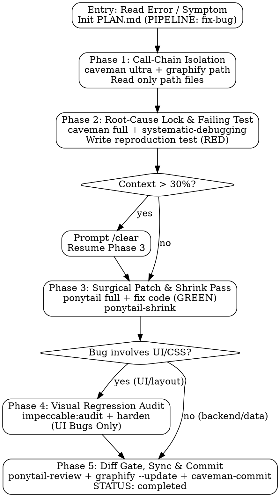

# Vibe Fix Bug

## Overview

Isolate and patch bugs in under three turns without blind trial-and-error loops. Combines `graphify` topological call-chain pathing, `superpowers` systematic debugging, `ponytail` minimal-diff shrinking, and conditional visual auditing.

Core principle: **Never guess a fix. Trace the call chain, write a failing reproduction test first, apply the smallest working patch, and strip defensive bloat.**



## When to Use

- Resolving runtime exceptions, 500 errors, stack traces, and unhandled promise rejections
- Fixing broken data mutations, calculation discrepancies, and logic regressions
- Debugging CSS layout overflow, z-index collisions, broken responsive states, or interaction glitches
- Halting AI trial-and-error guesswork when troubleshooting stubborn issues

**When NOT to use:**
- Building new capabilities or endpoints (use `vibe-add-feature`)
- Initializing a greenfield codebase (use `vibe-fresh-project`)
- Refactoring architecture without functional defects (use `ponytail` directly)

---

## Phase State Handshake (On Every Entry)

Inspect `PLAN.md` before taking action:

```markdown
---
PIPELINE: fix-bug
CURRENT_PHASE: <phase_number>
STATUS: <in_progress|completed>
---
```

1. **Fast-Forward from `vibe-explore-audit`:** If `PLAN.md` has `PIPELINE: fix-bug` and `CURRENT_PHASE: 3` (routed after exploration proved root cause and locked a failing reproduction test), jump directly to **Phase 3: Surgical Patch & Shrink Pass**. Skip Phases 1 and 2!
2. **Resuming after `/clear`:** If `PIPELINE: fix-bug` is active, jump directly to `CURRENT_PHASE`.
3. **Starting Fresh:** Write the initial triage details and suspect call chain into `PLAN.md`, set `CURRENT_PHASE: 1`, and begin Phase 1.

---

## 5-Phase Surgical Debugging Pipeline

### Phase 1: Call-Chain Isolation
**Tools:** `caveman ultra` + `graphify`

> [!IMPORTANT]
> **Use Path Tracing Over Text Grep:** Do NOT grep the entire repo for error strings. Query the AST knowledge graph to trace the exact topological path between entry and failure point.

1. Switch to ultra-compressed mode:
   ```
   /caveman ultra
   ```
2. Query graphify for the shortest path between the entry route/component and the failing function:
   ```
   /graphify path "from [entry point] to [failing function/module]"
   ```
3. Read **ONLY** the specific files and line ranges identified along that execution path.
4. Record the suspected call chain and file paths in `PLAN.md`.
5. Update `PLAN.md`: `CURRENT_PHASE: 2`.

---

### Phase 2: Root-Cause Lock & Failing Test
**Tools:** `caveman full` + `superpowers:systematic-debugging`

> [!CAUTION]
> **The Iron Law:** NEVER modify implementation code before reproducing the bug with a failing test. Guessing and re-running tests wastes more tokens than any other workflow anti-pattern.

1. Activate `superpowers:systematic-debugging` on the isolated files.
2. Form a single verifiable hypothesis explaining the failure mechanism.
3. Confirm the root cause in the source code.
4. **Write a minimal reproduction test** that reproduces the exact failure:
   - Run the test to confirm it fails (**RED**) with the exact reported error.
5. Update `PLAN.md`: `CURRENT_PHASE: 3`.
6. **Context Budget Check:** Because bug fixes are tightly scoped, you can continue in the same session. However, **if reading large stack traces, logs, or files pushed context usage above 30%**, update `PLAN.md` and prompt for `/clear` before proceeding to Phase 3.

---

### Phase 3: Surgical Patch & Shrink Pass
**Tools:** `caveman full` + `ponytail full` (`ponytail-shrink`)

1. Apply the smallest possible code change to turn the reproduction test green (**GREEN**).
2. Fix the true root cause—do not merely mask symptoms with optional chaining (`?.`) or blanket `try-catch` blocks.
3. Immediately run `ponytail-shrink` on the patched function to strip defensive bloat:
   ```
   /ponytail full
   /ponytail-shrink
   ```
   - Remove redundant null checks, speculative fallbacks, and dead branches.
4. Re-run reproduction and unit tests to verify clean pass.
5. Update `PLAN.md`: `CURRENT_PHASE: 4` (or `5` if headless).

---

### Phase 4: Conditional Visual Regression Audit (UI Bugs Only)
**Tools:** `impeccable` (`impeccable:audit`, `impeccable:harden`)

> [!TIP]
> **Skip on Backend/Data Bugs:** If the bug is purely in backend routes, database queries, math logic, or API contracts, **SKIP Phase 4 COMPLETELY** to save tokens and jump directly to Phase 5.

- **If the bug involves CSS layout, responsive breakpoints, z-index, animations, or UI states:**
  1. Run `impeccable:audit` on the patched component to ensure no visual regressions were introduced.
  2. Run `impeccable:harden` to verify edge cases (long text, empty states, touch targets >= 44x44px).
  3. Update `PLAN.md`: `CURRENT_PHASE: 5`.

---

### Phase 5: Diff Gate, Graph Sync & Commit
**Tools:** `ponytail full` (`ponytail-review`) + `graphify` + `caveman-commit`

1. Run `ponytail-review` against the git diff:
   ```
   /ponytail-review
   ```
   - Verify the diff contains **ONLY** the reproduction test and the surgical patch.
   - Ensure zero incidental formatting, no stray console logs, and zero defensive bloat.
2. If function signatures, exports, or module dependencies were altered, sync the AST graph:
   ```
   /graphify --update
   ```
3. Update `PLAN.md` frontmatter:
   ```yaml
   PIPELINE: fix-bug
   CURRENT_PHASE: 5
   STATUS: completed
   ```
4. Commit the fix using `caveman-commit`:
   ```
   /caveman-commit
   ```
5. Output final telegraphic completion summary:
   ```
   done: bug isolated, reproduced, patched, and verified. diff minimal, committed.
   ```

---

## Quick Reference

| Phase | Purpose | Active Tools | Key Constraints | Next Transition |
|---|---|---|---|---|
| **Phase 1** | Call-Chain Isolation | `caveman ultra`, `graphify path` | Read only path files; no whole-repo greps | `CURRENT_PHASE: 2` |
| **Phase 2** | Root Cause & Test | `caveman full`, `systematic-debugging` | Write failing test before touching code | `CURRENT_PHASE: 3` (clear if ctx > 30%) |
| **Phase 3** | Patch & Shrink | `ponytail full`, `ponytail-shrink` | Smallest diff; strip defensive bloat | `CURRENT_PHASE: 4` (or 5 if non-UI) |
| **Phase 4** | Visual Audit (UI Only) | `impeccable:audit`, `impeccable:harden` | Skip completely on backend/data bugs | `CURRENT_PHASE: 5` |
| **Phase 5** | Diff Gate & Commit | `ponytail-review`, `graphify --update`, `caveman-commit` | Zero diff noise; atomic commit | `STATUS: completed` |

---

## Rationalization Table

| Excuse | Reality |
|---|---|
| "The bug is obvious from the stack trace, I'll just patch it right away without a test." | Guessing creates trial-and-error loops, masks root causes, and risks silent regressions. A reproduction test takes 60 seconds and guarantees proof. |
| "I'll wrap it in optional chaining (`?.`) and a try-catch so it won't crash." | Symptom-masking silently swallows errors, corrupts downstream state, and creates hard-to-diagnose phantom bugs. Fix the actual invariant. |
| "I'll run grep across the codebase to see where this error is." | Recursive grep dumps noise and irrelevant matches. `/graphify path` extracts the exact topological execution chain instantly. |
| "Let me audit the whole page with impeccable just in case." | Loading UI audit tools on backend/API fixes wastes thousands of tokens. Phase 4 is strictly conditional on UI/layout bugs. |
| "I don't need `ponytail-shrink` because my patch is small." | Quick fixes often add defensive null checks and speculative fallbacks. `ponytail-shrink` ensures only essential lines remain. |

---

## Red Flags - STOP and Correct

- Modifying application code before running a failing reproduction test.
- Applying optional chaining or blanket `try-catch` blocks to silence errors instead of fixing the root cause.
- Grepping raw source directories when `graphify path` can trace the exact execution path.
- Loading `impeccable` or visual audit tools during backend, database, or API bug fixes.
- Skipping `ponytail-review` before committing the patch.
