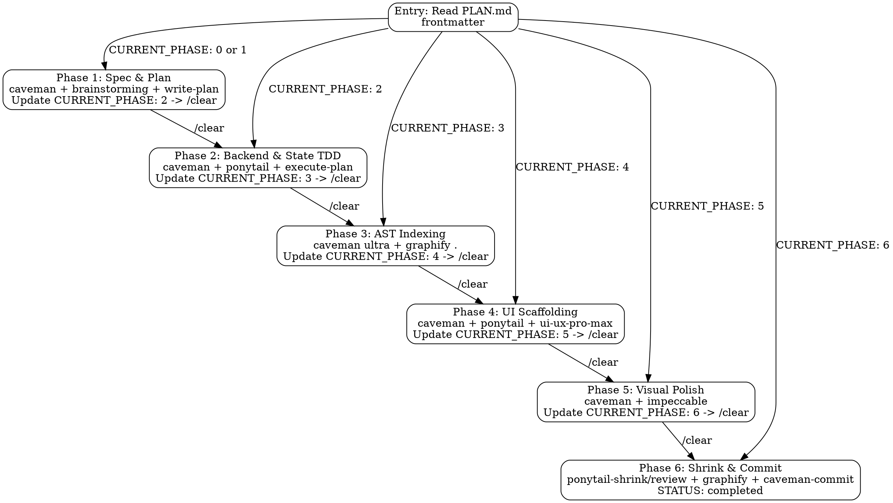

# Vibe Fresh Project

## Overview

Orchestrate a token-optimized 6-phase greenfield software build using strict context isolation and disk-backed state handoffs (`PLAN.md`). Backend TDD, structural AST indexing, UI scaffolding, and visual polish run in separate context windows so prompt instructions and file contexts never pollute one another.

Core principle: **Never mix architectural phases in the same context window. Update `PLAN.md` to disk, prompt `/clear`, and resume.**



## When to Use

- Building a new application, web service, CLI tool, or product from scratch
- Resuming an in-progress greenfield build after running `/clear`
- Enforcing strict token separation between backend data logic, AST indexing, UI scaffolding, and visual polish

**When NOT to use:**
- Adding a single feature to an existing codebase (use `vibe-add-feature`)
- Fixing a bug or regression in an established project (use `vibe-fix-bug`)
- Initializing repository rules and configs before starting (use `vibe-init`)

---

## Phase State Handshake (On Every Entry)

Always inspect the YAML frontmatter of `PLAN.md` before executing any actions:

```markdown
---
PIPELINE: fresh-project
CURRENT_PHASE: <phase_number>
STATUS: <idle|in_progress|completed>
---
```

1. If `PIPELINE: fresh-project` is active and `CURRENT_PHASE > 0`: jump directly to that phase.
2. If starting fresh (`PIPELINE: none` or missing): set `PIPELINE: fresh-project`, `CURRENT_PHASE: 1`, `STATUS: in_progress`, and begin Phase 1.

---

## 6-Phase Pipeline

### Phase 1: Zero-Bloat Spec & Task Plan
**Tools:** `caveman full` + `superpowers:brainstorming` + `superpowers:write-plan`

1. Clarify ambiguous requirements using terse, Socratic questions.
2. Produce minimal, concrete schema definitions, API contracts, and an atomic task checklist.
3. Write the finalized spec and task plan into `PLAN.md`.
4. Update `PLAN.md` frontmatter:
   ```yaml
   PIPELINE: fresh-project
   CURRENT_PHASE: 2
   STATUS: in_progress
   ```
5. **STOP.** Output the readiness prompt instructing the user:
   ```
   phase 1 complete: spec & tasks written to PLAN.md.
   run /clear then invoke vibe-fresh-project
   ```

---

### Phase 2: Headless Backend & State TDD
**Tools:** `caveman full` + `ponytail full` + `superpowers:execute-plan`

> [!CAUTION]
> **Strict Isolation Rule:** Do NOT load `ui-ux-pro-max` or `impeccable` in this phase. Do NOT build UI components or JSX layout.

1. Read `PLAN.md` to retrieve backend/state tasks.
2. Execute data layer, database migrations, API routes, core business logic, and client-state custom hooks using Red-Green-Refactor TDD.
3. Follow `ponytail full`: zero speculative abstractions, zero unrequested helper wrappers, minimal idiomatic code.
4. Verify all unit and integration tests pass.
5. Update `PLAN.md` frontmatter:
   ```yaml
   PIPELINE: fresh-project
   CURRENT_PHASE: 3
   STATUS: in_progress
   ```
6. **STOP.** Output the readiness prompt instructing the user:
   ```
   phase 2 complete: backend & state tests green.
   run /clear then invoke vibe-fresh-project
   ```

---

### Phase 3: Structural Baseline Indexing
**Tools:** `caveman ultra` + `graphify`

1. Index the newly built backend and state layer so subsequent UI phases do not need to read raw backend files:
   ```
   /caveman ultra
   /graphify .
   ```
2. Confirm `graphify-out/GRAPH_REPORT.md` is populated with exported models, route contracts, and state hook signatures.
3. Update `PLAN.md` frontmatter:
   ```yaml
   PIPELINE: fresh-project
   CURRENT_PHASE: 4
   STATUS: in_progress
   ```
4. **STOP.** Output the readiness prompt instructing the user:
   ```
   phase 3 complete: ast graph indexed to graphify-out/.
   run /clear then invoke vibe-fresh-project
   ```

---

### Phase 4: Design System & UI Scaffolding
**Tools:** `caveman full` + `ponytail full` + `ui-ux-pro-max`

> [!IMPORTANT]
> **Keep `impeccable` unloaded during scaffolding.** Do not mix aesthetic critique rules into component wiring.

1. Read `PLAN.md` and consult `graphify-out/GRAPH_REPORT.md` for hook and API types (avoid loading raw server files into context).
2. Invoke `ui-ux-pro-max` with `ponytail full` to establish design tokens (palette, typography scale, spacing grid).
3. Scaffold functional UI views and wire them directly to Phase 2 hooks.
4. Verify functional rendering and baseline component compilation.
5. Update `PLAN.md` frontmatter:
   ```yaml
   PIPELINE: fresh-project
   CURRENT_PHASE: 5
   STATUS: in_progress
   ```
6. **STOP.** Output the readiness prompt instructing the user:
   ```
   phase 4 complete: ui components scaffolded and wired.
   run /clear then invoke vibe-fresh-project
   ```

---

### Phase 5: Anti-Slop Visual Polish
**Tools:** `caveman full` + `impeccable` (`critique`, `polish`, `distill`)

1. Load `impeccable` in a clean context window focused strictly on the newly scaffolded UI files.
2. Audit visual hierarchy, reading measure (`<= 65ch`), tabular numerals (`tabular-nums`), interactive hit areas (`>= 44x44px`), and GPU-only motion (`transform`, `opacity`).
3. Run `critique`, `polish`, and `distill` to eliminate redundant container divs and sloppy styling defaults.
4. Verify layout integrity across target viewports.
5. Update `PLAN.md` frontmatter:
   ```yaml
   PIPELINE: fresh-project
   CURRENT_PHASE: 6
   STATUS: in_progress
   ```
6. **STOP.** Output the readiness prompt instructing the user:
   ```
   phase 5 complete: ui polished and distilled.
   run /clear then invoke vibe-fresh-project
   ```

---

### Phase 6: Shrink Audit, Graph Sync & Commit
**Tools:** `ponytail full` (`ponytail-shrink`, `ponytail-review`) + `graphify` + `caveman-commit`

1. Run `ponytail-shrink` and `ponytail-review` to detect and eliminate dead imports, unused state wrappers, or bloat added during UI wiring.
2. Update the knowledge graph with finalized components and routes:
   ```
   /graphify --update
   ```
3. Update `PLAN.md` frontmatter:
   ```yaml
   PIPELINE: fresh-project
   CURRENT_PHASE: 6
   STATUS: completed
   ```
4. Commit the complete greenfield build using `caveman-commit`:
   ```
   /caveman-commit
   ```
5. Output final telegraphic completion summary:
   ```
   done: greenfield build complete. all tests passing, graph synced, committed.
   next: run vibe-explore-audit to perform end-to-end verification.
   ```

---

## Quick Reference

| Phase | Purpose | Active Tools | Inactive / Forbidden Tools | Next Transition |
|---|---|---|---|---|
| **Phase 1** | Spec & Atomic Plan | `caveman`, `brainstorming`, `write-plan` | Code editing tools, UI tools | `CURRENT_PHASE: 2` -> `/clear` |
| **Phase 2** | Backend & State TDD | `caveman`, `ponytail`, `execute-plan` | `ui-ux-pro-max`, `impeccable`, UI JSX | `CURRENT_PHASE: 3` -> `/clear` |
| **Phase 3** | Structural Indexing | `caveman ultra`, `graphify` | All UI and editing tools | `CURRENT_PHASE: 4` -> `/clear` |
| **Phase 4** | UI Scaffolding | `caveman`, `ponytail`, `ui-ux-pro-max` | `impeccable`, raw backend files | `CURRENT_PHASE: 5` -> `/clear` |
| **Phase 5** | Visual Polish | `caveman`, `impeccable` | Backend code, `ui-ux-pro-max` | `CURRENT_PHASE: 6` -> `/clear` |
| **Phase 6** | Audit, Sync & Commit | `ponytail-shrink`, `graphify`, `caveman-commit` | Speculative refactorings | `STATUS: completed` |

---

## Rationalization Table

| Excuse | Reality |
|---|---|
| "The user asked to build everything right now without pauses, so I'll skip `/clear`." | Running backend TDD and frontend UI in the same window causes severe attention degradation, token bloat, and prompt collision. Phased `/clear` is non-negotiable. |
| "I can load `ui-ux-pro-max` and `impeccable` together in Phase 4 to save a step." | Bundling them mixes generation rules with critique rules and causes layout thrashing. Scaffold first in Phase 4, polish in Phase 5. |
| "I'll read raw backend files in Phase 4 to check API types." | Raw files pollute UI context. Phase 3 indexes the AST so Phase 4 reads types cleanly from `graphify-out/GRAPH_REPORT.md`. |
| "I can tell the user to `/clear` and update `PLAN.md` later." | If `PLAN.md` is not updated to disk before `/clear`, the session loses its phase counter and restarts at Phase 1. |
| "I don't need `ponytail-shrink` in Phase 6 because I wrote clean code." | UI wiring frequently introduces unused imports and wrapper divs. Phase 6 guarantees zero residual bloat before commit. |

---

## Red Flags - STOP and Correct

- Proceeding to the next phase without updating `CURRENT_PHASE` in `PLAN.md` to disk first.
- Continuing to code across phase boundaries without prompting the user to `/clear`.
- Loading `ui-ux-pro-max` or `impeccable` during Phase 2.
- Loading `impeccable` during Phase 4 scaffolding.
- Skipping Phase 3 AST indexing and grepping raw server code during frontend phases.
- Using standard verbose git commit messages instead of `/caveman-commit`.
