# Vibe Init

## Overview

Bootstrap any repository with persistent compression rules, local skill dependencies, phase-handoff state tracking, and initial AST knowledge graph indexing so baseline prompts and context resets never lose state or waste tokens across sessions.

Core principle: **Set static rules, install missing skillset dependencies locally, and index the AST graph once; never repeat prompt setup.**

```dot
digraph vibe_init_flow {
    rankdir=LR;
    node [shape=box, style=rounded];

    start [label="Repository Root"];
    check_skills [label="Check Skillset\nGlobal & Local"];
    install_missing [label="Install Missing Skills\nLocally in .agents/skills/"];
    check_agents [label="AGENTS.md exists?"];
    merge_agents [label="Merge Protocol\nPreserve commands"];
    create_agents [label="Create AGENTS.md\n+ Sync CLAUDE.md"];
    init_plan [label="Create PLAN.md\nFrontmatter State"];
    update_gitignore [label="Append .vibe-temp/\nto .gitignore"];
    check_sources [label="Source files exist?"];
    index_graph [label="/caveman ultra\n/graphify .\n/clear"];
    finish [label="Output Single\nReadiness Line"];

    start -> check_skills;
    check_skills -> install_missing [label="missing skills"];
    check_skills -> check_agents [label="all present\n(SKIP install)"];
    install_missing -> check_agents;
    check_agents -> merge_agents [label="yes"];
    check_agents -> create_agents [label="no"];
    merge_agents -> init_plan;
    create_agents -> init_plan;
    init_plan -> update_gitignore;
    update_gitignore -> check_sources;
    check_sources -> index_graph [label="yes (existing)"];
    check_sources -> finish [label="no (greenfield)"];
    index_graph -> finish;
}
```



## When to Use

- Initializing a brand-new repository before running greenfield pipelines (e.g. `vibe-fresh-project`)
- Onboarding an existing repository to the token-efficient vibe coding workflow
- Detecting missing vibe coding skills and installing them locally into the project folder (`.agents/skills/`)
- Generating or updating `AGENTS.md` and `CLAUDE.md` with global compression and exploration constraints
- Setting up disk-based phase tracking (`PLAN.md`) so `/clear` resets do not lose pipeline progress

**When NOT to use:**
- During active feature development or bugfixing (use `vibe-add-feature` or `vibe-fix-bug` instead)
- When only styling or auditing an existing UI component (do not re-initialize the repository)

---

## Step-by-Step Implementation

### Step 1: Idempotent Skillset Check (Install ONLY If Missing)

> [!IMPORTANT]
> **Strict Idempotency Guard (DO NOT RE-INSTALL):**
> If a required skill is ALREADY installed either **globally** (in `~/.agents/skills/`, `~/.gemini/skills/`, `~/.claude/skills/`, or global CLI plugins) OR **locally** (in `<project-root>/.agents/skills/`), **DO NOT RE-INSTALL IT. SKIP IT.**
> - **NEVER** run batch install commands (`npx skills add KarlCabasagan/vibing-karl -y`) if skills are already present.
> - **NEVER** re-download, overwrite, or duplicate existing skills.
> - If all required skills are already present globally or locally: **ZERO installation commands are executed.** Proceed immediately to Step 2.

**Required Skillset:**
1. `caveman` (and `caveman-commit`)
2. `ponytail` (and `ponytail-shrink`, `ponytail-review`, `ponytail-debt`)
3. `graphify`
4. `superpowers` (or `brainstorming`, `write-plan`, `execute-plan`, `systematic-debugging`)
5. `ui-ux-pro-max`
6. `impeccable`
7. `vibe-fresh-project`, `vibe-add-feature`, `vibe-fix-bug`, `vibe-explore-audit`

**Detection & Installation Procedure:**
1. For each required skill `S`, test:
   - Does `S` exist in global runtime paths (`~/.agents/skills/S`, `~/.gemini/skills/...`, `~/.claude/skills/...`)? -> If YES, **SKIP `S`**.
   - Does `S` exist in local project directory (`.agents/skills/S`)? -> If YES, **SKIP `S`**.
2. **Only for skills confirmed missing from BOTH global and local locations:**
   Install ONLY that specific missing skill locally into `.agents/skills/<skill-name>`:
   ```bash
   npx skills add KarlCabasagan/vibing-karl@<skill-name> -y
   ```
   *(Or fetch/scaffold the skill definition directly into `.agents/skills/<skill-name>/SKILL.md`).*
3. If all skills already exist: skip all install steps and proceed directly to Step 2.

> [!CAUTION]
> **Installing Locally vs. Loading Into Context:** Installing a missing skill locally places its files in `<project-root>/.agents/skills/` so future pipeline phases can load it on demand. It does **NOT** mean loading `ui-ux-pro-max`, `impeccable`, or `superpowers` into the active conversation context during initialization. Keep the initialization session context lean.

---

### Step 2: Create or Update AGENTS.md and CLAUDE.md

Write the following persistent instructions to `AGENTS.md` (and copy to `CLAUDE.md` if needed) at the project root so compression and exploration constraints load automatically without manual prompting:

```markdown
# Global Vibe Coding Protocol

## Always-On Compression
- **Prose (`caveman`):** Default to `caveman full` at all times. Use telegraphic, high-precision technical fragments. Drop pleasantries, hedging, filler, and summaries. Switch to `caveman ultra` for status checks and graph queries.
- **Code (`ponytail`):** Default to `ponytail full` during implementation. Write minimal, idiomatic code. Zero speculative abstractions, zero premature helper wrappers, zero unrequested comments.

## Context & Exploration Rules
- **Never grep or dump raw directories:** Before reading source files, inspect `graphify-out/GRAPH_REPORT.md` or run `/graphify query` to locate exact target files and line ranges.
- **Phase State Handshake:** Always read `PLAN.md` first when resuming a pipeline after `/clear` to identify the active `PIPELINE` and `CURRENT_PHASE`.

## Isolation Rules
- Never load `ui-ux-pro-max` or `impeccable` during backend/state TDD phases.
- Never modify unrelated code outside the active phase scope.

## Git Protocol
- Always commit via `/caveman-commit`: imperative subject under 50 chars, terse why-over-what body if non-obvious, zero AI attribution footers.
```

> [!IMPORTANT]
> **Preserve Existing Build and Test Commands:** If `AGENTS.md` already exists, **MERGE** the `# Global Vibe Coding Protocol` section into the existing file. NEVER wipe or overwrite project-specific build, run, test, Docker, or deployment commands.

---

### Step 3: Initialize Disk Handoff Tracker (`PLAN.md`)

Create a lightweight `PLAN.md` file at the project root to survive `/clear` context resets across pipeline phases:

```markdown
---
PIPELINE: none
CURRENT_PHASE: 0
STATUS: idle
---
# Active Execution Plan

No active pipeline. Invoke `vibe-fresh-project`, `vibe-add-feature`, `vibe-fix-bug`, or `vibe-explore-audit` to begin.
```

If `PLAN.md` already exists with an ongoing pipeline, do not reset it unless explicitly instructed.

---

### Step 4: Configure `.gitignore` for Local Artifacts

Append temporary agent scratch artifacts to `.gitignore` to prevent cluttering version control, while ensuring `graphify-out/GRAPH_REPORT.md` remains trackable:

```gitignore
# Vibe coding local state
.vibe-temp/
```

---

### Step 5: Bootstrap the Knowledge Graph (Existing Codebases Only)

Check if the repository already contains source files (e.g. `src/`, `lib/`, `package.json`, `go.mod`, `pyproject.toml`).

- **If source files exist:** Build the initial knowledge graph immediately in compressed mode, then reset the context window:
  ```
  /caveman ultra
  /graphify .
  /clear
  ```
- **If greenfield (empty repository):** Skip AST graph indexing. The graph will be built after initial project scaffolding.

---

### Step 6: Verify Initialization

Confirm that `AGENTS.md` (and/or `CLAUDE.md`), `PLAN.md`, and any locally installed skills in `.agents/skills/` exist at the repository root.

Output a single telegraphic readiness line:
```
ready: repo initialized (skills: verified, 0 missing). run vibe-fresh-project (or vibe-add-feature / vibe-fix-bug / vibe-explore-audit).
```
*(If missing skills were installed: `ready: repo initialized (installed N missing skills locally). run ...`)*

---

## Quick Reference

| Component | Target Location | Action | Constraint |
|---|---|---|---|
| **Skillset Dependencies** | Global or `.agents/skills/<skill>` | Check existence; install ONLY if missing | DO NOT re-install or duplicate existing skills |
| **Protocol** | `AGENTS.md` / `CLAUDE.md` | Create or merge | Preserve existing build/test scripts |
| **State Tracker** | `PLAN.md` | Create | Exact YAML frontmatter (`PIPELINE`, `CURRENT_PHASE`, `STATUS`) |
| **Git Ignore** | `.gitignore` | Append `.vibe-temp/` | Keep `graphify-out/GRAPH_REPORT.md` trackable |
| **AST Index** | `graphify-out/` | `/graphify .` (if sources exist) | Run under `/caveman ultra`, then `/clear` |
| **Verification** | Terminal / Output | 1-line confirmation | Single telegraphic line, zero conversation filler |

---

## Rationalization Table

| Excuse | Reality |
|---|---|
| "I will re-run `npx skills add` just to be sure or keep them updated." | Re-installing skills that already exist globally or locally wastes network, overwrites customizations, and bloats init. If already installed, SKIP. |
| "The skills aren't installed globally, so I will tell the user to install them manually." | `vibe-init` must detect missing dependencies and install them locally into `.agents/skills/` automatically so the project is self-contained. |
| "I installed `ui-ux-pro-max` locally, so I should load it into the session right now." | Installing a skill to disk (`.agents/skills/`) is not the same as loading it. Pre-loading design skills during init floods context with hundreds of unneeded rules. |
| "The user asked for clean fresh instructions so I will overwrite existing AGENTS.md." | Overwriting destroys institutional knowledge (build, deploy, test commands). Merge the protocol instead. |
| "I can skip `PLAN.md` or create a bespoke design document instead." | `PLAN.md` with structured frontmatter is mandatory for surviving `/clear` across pipeline phases. |
| "I will grep the codebase to see what packages are installed." | Never grep or dump directories manually. Index via `/graphify .` so AST relationships are structured. |

---

## Red Flags - STOP and Correct

- Executing installation commands or creating local folders for skills that are already installed globally or locally.
- Failing to check if required skillset skills exist globally or locally.
- Failing to install missing skills locally into `.agents/skills/`.
- Pre-loading `ui-ux-pro-max`, `impeccable`, or `superpowers` into the active conversation context during initialization.
- Overwriting an existing `AGENTS.md` and dropping existing build/deploy scripts.
- Omitting `PLAN.md` or altering its frontmatter schema (`PIPELINE`, `CURRENT_PHASE`, `STATUS`).
- Emitting conversational paragraphs or pleasantries in the final response.
